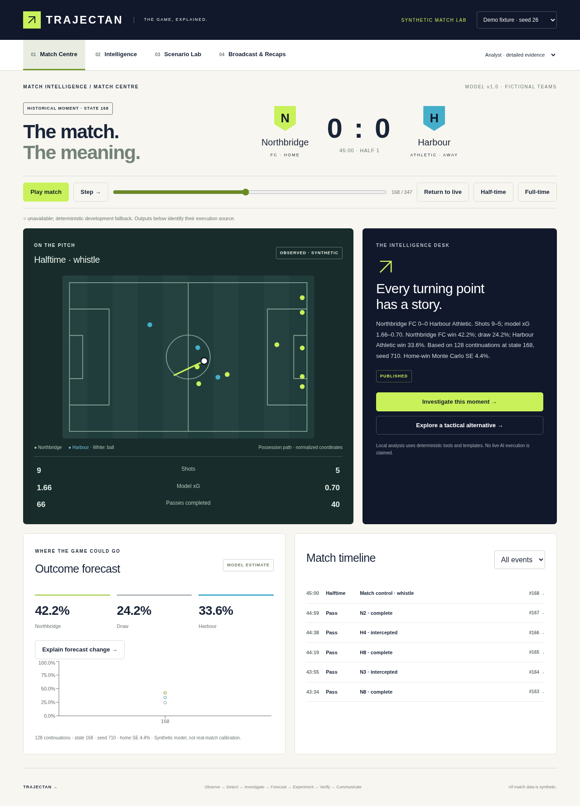

# Trajectan

**The game, explained.** A working synthetic football intelligence application: seeded matches, reproducible forecasts, evidence-linked investigations, hypothetical tactical branches, and personalized broadcast recaps.



The application uses fictional teams and generated events. Forecasts and xG are outputs of an illustrative model, **not calibrated predictions of real Premier League matches**.

## Run locally

Requires Python 3.12 and Node.js 24. From the repository root:

```bash
./scripts/dev.sh
```

Open **http://localhost:8000**. This installs dependencies, builds the frontend, and starts FastAPI serving both UI and API. SQLite and a durable local queue are the explicitly labelled development defaults. No Azure account is needed for this mode.

Manual setup:

```bash
python3 -m venv .venv
.venv/bin/pip install -r backend/requirements.txt
npm ci --prefix frontend
npm run build --prefix frontend
PYTHONPATH=backend .venv/bin/uvicorn trajectan.api:app --host 0.0.0.0 --port 8000
```

For frontend development, run `npm run dev --prefix frontend` alongside the API. Vite proxies `/api` to port 8000. API documentation: `/docs`. Environment variables are read from the server process; `.env.example` documents configuration and is not automatically loaded.

## Try the complete journey

1. Select seed **26** and press **Play match**. The SSE stream advances individual events. Goals, dismissals and half-time trigger background investigations.
2. Select **Half-time**, or use the timeline/range slider to pin a historical state. The score, pitch, statistics, evidence and forecasts follow that cursor.
3. Choose **Investigate this moment**. Inspect real analytical tool operations, source events, publication validation and the execution-mode label in Intelligence.
4. Open **Scenario Lab**, increase Northbridge's pressing, and run paired simulations. Compare probabilities and paired sampling uncertainty. The source history remains unchanged.
5. Open **Broadcast & Recaps**. Switch between Viewer and Analyst, then export a verified JSON overlay. Half-time/full-time controls select the corresponding recap.

The initial forecast may take a few seconds. During playback forecasts refresh at 20-event checkpoints; their source state is shown. The chart contains forecasts calculated for visited checkpoints, not invented historical curves.

## What works and what remains external

- React/TypeScript/Vite, Tailwind, Recharts and custom SVG pitch; four synchronized, responsive workspaces.
- One Python tactical transition kernel for event generation, forecasts and scenarios; legal reducer, deterministic replay, hashed checkpoints, player attributes and seed metadata.
- Immutable persisted event/snapshot artifacts, local SQLite or configured PostgreSQL through SQLAlchemy.
- Outcome probabilities with sample counts and Monte Carlo standard errors; ordered grouped forecast-change attribution with a reconciliation residual.
- Pressing, compactness, directness, substitution and role interventions; separately labelled goal, dismissal and injury premises.
- Bounded investigation controller, allowlisted tool plans, independent numeric/provenance validation, terminal rejection/failure/inconclusive states, linked investigation memory.
- Real Microsoft Agent Framework **1.23.0** and Foundry connector **1.15.0** adapter for three model roles. SDK construction and cleanup are tested. **Live Foundry inference has not been exercised.** Local operation uses deterministic planning and templates, clearly labelled in the UI and traces.
- Durable job outbox, lease-based claiming, restart recovery and optional Azure Service Bus delivery. **Azure send/receive and PostgreSQL operation have not been exercised.**
- Docker build definition, Azure Bicep template and GitHub Actions verification workflow. **No Azure resources have been provisioned and no public deployment is claimed.**

See [capability status and remaining work](docs/STATUS.md), [architecture and model assumptions](docs/ARCHITECTURE.md), [deployment](docs/DEPLOYMENT.md), and [verification evidence](docs/VERIFICATION.md).

## Verify

```bash
.venv/bin/pytest -q
npm run build --prefix frontend
# Start the API first, then:
cd frontend
npx playwright install chromium
npm run test:e2e
# Or use an existing Chromium:
CHROMIUM_PATH=/usr/bin/chromium npm run test:e2e
```

Synthetic evaluation and API contract generation:

```bash
PYTHONPATH=backend .venv/bin/python evals/evaluate.py
PYTHONPATH=backend .venv/bin/python scripts/export_contract.py
cd frontend
npx openapi-typescript ../docs/openapi.json -o src/api-schema.d.ts
```

[evaluation results](evals/results.json) include 20 held-out synthetic matches, seeds 100–119, 64 half-time continuations per match, reliability bins, Brier and log-loss definitions. This small internal evaluation does not establish external accuracy or an advantage over single-agent systems.

## Microsoft configuration

Install `backend/requirements-azure.txt` (or the tested full environment in `backend/requirements-azure.lock`). Set `FOUNDRY_PROJECT_ENDPOINT` and `FOUNDRY_MODEL`, and provide an authorized Azure identity through `DefaultAzureCredential`. Set `SERVICE_BUS_NAMESPACE` and `SERVICE_BUS_QUEUE` for Service Bus. Set `DATABASE_URL` for PostgreSQL. Keep all credentials server-side.

Inference uses three specialized `Agent` instances with `FoundryChatClient`: Investigation chooses a structured allowlisted plan; Evidence & Reasoning reviews the returned evidence; Narrative selects a structured factual presentation. Deterministic application code controls handoffs, budgets and publication. Free-form model prose is not published: approved claims drive safe renderers.

The owner confirmed an existing succeeded **agentgate** project / **gpt-4.1-mini** deployment and active Azure for Students subscription. This runtime still has no Azure identity, credentials or project endpoint configured. Reuse the existing deployment; after server-side configuration run `PYTHONPATH=backend .venv/bin/python scripts/verify_foundry.py` for actual three-role inference verification. Remaining subscription credits are unverified.

## Ownership and competition

Original graphics and fictional identities are included; no official team marks, footage or real match dataset is used. Dependency license metadata is recorded in `docs/dependency-licenses.json`. The repository's own license remains an owner decision; no license grant has been selected on the owner's behalf.

The live [official rules](https://github.com/microsoft/insidethegamehackathon/blob/main/OFFICIAL%20RULES.md), checked 27 October 2026, state submission closes 27 October 2026 at 23:59 Pacific: **28 October 2026, 08:59 SAST**. Registration, eligibility, public video, judge-accessible deployment and actual portal submission remain owner/external checks. See [submission runbook](docs/SUBMISSION.md).
